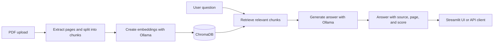

<div align="center">

# Enterprise RAG System

### Ask questions across your PDF knowledge base—with source citations.

A containerized Retrieval-Augmented Generation (RAG) application with a FastAPI backend, Streamlit chat interface, local Ollama inference, and persistent ChromaDB vector storage.

[](https://github.com/enesozturk0/enterprise-rag-system/actions/workflows/ci.yml)
[](https://www.python.org/)
[](https://fastapi.tiangolo.com/)
[](https://docs.docker.com/compose/)

[Quick start](#quick-start) · [Architecture](#how-it-works) · [API](#api-overview) · [Evaluation](#rag-evaluation)

</div>

---

## Overview

Upload PDF documents, index their content, and ask natural-language questions grounded in those documents. Answers include source filenames, page numbers, and retrieval scores so users can inspect the supporting passages.

The project brings together document ingestion, vector search, local language-model inference, an authenticated API, a web UI, and a golden-question evaluation suite.

## Highlights

- **PDF ingestion pipeline** with filename, file-signature, and configurable upload-size checks
- **Page-aware text extraction and chunking** that retains source and page metadata
- **Semantic retrieval** using Ollama embeddings and a persistent ChromaDB collection
- **Grounded answers with source details** returned alongside each response
- **Streamlit chat interface** for uploading documents and asking questions
- **API key protection** for document and query routes
- **Operational endpoints** for health checks and Prometheus metrics
- **RAG evaluation suite** with a golden question set, retrieval and answer metrics, and a configurable quality gate
- **Docker Compose deployment** with separate API, UI, and Ollama services

## Technology

| Layer | Technologies |
| --- | --- |
| API | FastAPI, Pydantic |
| User interface | Streamlit |
| LLM and embeddings | Ollama — `llama3.1:8b` and `bge-m3` by default |
| Vector store | ChromaDB |
| PDF processing | PyMuPDF |
| Evaluation | Retrieval metrics, optional RAGAS metrics, quality gate |
| Packaging and deployment | Python 3.11+, Docker, Docker Compose |

## How it works



The API and UI run as separate services. Ollama is available to the API over the internal Compose network; its port is not published to the host. Named volumes preserve the vector index and downloaded Ollama models.

## Quick start

### Prerequisites

- Docker Desktop or Docker Engine
- Docker Compose v2
- At least 8 GB RAM recommended
- At least 10 GB free disk space recommended for model files

The default models are `llama3.1:8b` and `bge-m3`. Downloading them requires several gigabytes and can take a while on the first run.

### 1. Configure the environment

Copy the example environment file:

**PowerShell**

```powershell
Copy-Item .env.production.example .env
```

**macOS / Linux**

```bash
cp .env.production.example .env
```

Set `API_KEY` and `RAG_API_KEY` to the **same strong random secret** in `.env`. For example, generate one with Python:

```bash
python -c "import secrets; print(secrets.token_urlsafe(32))"
```

Do not commit `.env`.

### 2. Build and start the services

```bash
docker compose up --detach --build
```

### 3. Download the Ollama models

The current Compose stack does not include a model-initialization container. Pull the models directly into the running Ollama service:

```bash
docker compose exec ollama ollama pull llama3.1:8b
docker compose exec ollama ollama pull bge-m3
```

Check service status and follow logs:

```bash
docker compose ps
docker compose logs --follow
```

### 4. Open the application

- **Streamlit UI:** [http://127.0.0.1:8501](http://127.0.0.1:8501)
- **FastAPI Swagger UI:** [http://127.0.0.1:8000/docs](http://127.0.0.1:8000/docs)
- **Health check:** [http://127.0.0.1:8000/health](http://127.0.0.1:8000/health)
- **Prometheus metrics:** [http://127.0.0.1:8000/metrics](http://127.0.0.1:8000/metrics)

Upload a PDF from the Streamlit sidebar. Once indexing completes, ask a question and inspect the source details shown with the answer.

## API overview

Interactive API documentation is available at `/docs`. Protected endpoints require the `X-API-Key` header, configured with `API_KEY` in `.env`.

| Method | Endpoint | Description |
| --- | --- | --- |
| GET | `/health` | API liveness check |
| POST | `/api/v1/documents/upload` | Upload and index a PDF |
| GET | `/api/v1/documents/stats` | Get the total indexed chunk count |
| DELETE | `/api/v1/documents` | Delete indexed chunks for a source filename |
| POST | `/api/v1/query` | Answer a question using indexed documents |
| GET | `/metrics` | Prometheus metrics |

### Example: ask a question

```bash
curl -X POST http://127.0.0.1:8000/api/v1/query \
  -H "Content-Type: application/json" \
  -H "X-API-Key: YOUR_API_KEY" \
  -d '{
    "question": "What does the document say about the warranty?",
    "top_k": 5
  }'
```

The response includes the generated answer, model name, duration, and source details such as filename and page number.

### Example: upload a PDF

```bash
curl -X POST http://127.0.0.1:8000/api/v1/documents/upload \
  -H "X-API-Key: YOUR_API_KEY" \
  -F "file=@./document.pdf"
```

The maximum upload size is configurable with `API_MAX_UPLOAD_SIZE_MB`.

## RAG evaluation

The repository includes a golden question set at `data/eval/golden_qa.yaml` and an evaluation runner with retrieval metrics, optional answer-quality metrics, and threshold-based quality checks.

To install development and evaluation dependencies:

```bash
python -m pip install --editable ".[dev,eval]"
```

Evaluation requires Ollama, the configured models, and a **non-empty indexed ChromaDB collection**. Index documents before running:

```bash
python -m scripts.run_evaluation
```

The default results file is `data/eval/results.json`. The CLI supports custom datasets, output paths, retrieval depth, and quality thresholds:

```bash
python -m scripts.run_evaluation --help
```

## Developer workflow

For local quality checks, install the development dependencies:

```bash
python -m pip install --editable ".[dev]"
```

**Windows PowerShell**

```powershell
.\scripts\dev.ps1 quality
.\scripts\dev.ps1 docker-config
.\scripts\dev.ps1 test
```

**macOS / Linux (GNU Make)**

```bash
make quality
make docker-config
make test
```

The quality workflow runs Ruff lint and format checks, MyPy, and unit tests with a 95% coverage threshold. Integration tests require the external Ollama and Chroma-backed services:

```powershell
.\scripts\dev.ps1 test-all
```

## Common Docker commands

```bash
# Inspect services
docker compose ps

# Follow API logs
docker compose logs --follow api

# Restart services
docker compose restart

# Stop services; named volumes remain
docker compose down

# Build the application images
docker compose build api ui
```

To remove the persistent Chroma index and Ollama models as well, remove the named volumes explicitly with `docker compose down --volumes`.

## Configuration

The main settings are documented in `.env.production.example`. Common options include:

| Variable | Purpose |
| --- | --- |
| `LLM_MODEL_NAME` | Ollama generation model |
| `EMBEDDING_MODEL_NAME` | Ollama embedding model |
| `CHUNK_SIZE`, `CHUNK_OVERLAP` | Text chunking behavior |
| `RETRIEVAL_TOP_K` | Default number of retrieved chunks |
| `API_KEY`, `RAG_API_KEY` | API authentication key and UI client key |
| `API_PORT`, `UI_PORT`, `BIND_ADDRESS` | Host binding and published ports |
| `CHROMA_PERSIST_DIR` | Persistent vector-store location |

## Project structure

```text
.
├── docker/             # API and UI Docker images, Gunicorn configuration
├── data/eval/          # Golden evaluation questions
├── scripts/            # Ingestion, indexing, query, evaluation, and dev tools
├── src/api/            # FastAPI routes, schemas, dependencies, middleware
├── src/config/         # Environment-based application settings
├── src/evaluation/     # Metrics, evaluation runner, and quality gate
├── src/ingestion/      # PDF loading, preprocessing, and chunking
├── src/rag/             # Retrieval, prompts, generation, and RAG chain
├── src/ui/              # Streamlit application and API client
├── src/vectorstore/     # Embeddings, indexing, and ChromaDB adapter
├── tests/               # Unit, API, UI, and integration tests
├── compose.yaml         # Local multi-service stack
└── pyproject.toml        # Dependencies and developer tooling
```

## License

No license is currently specified in this repository.
